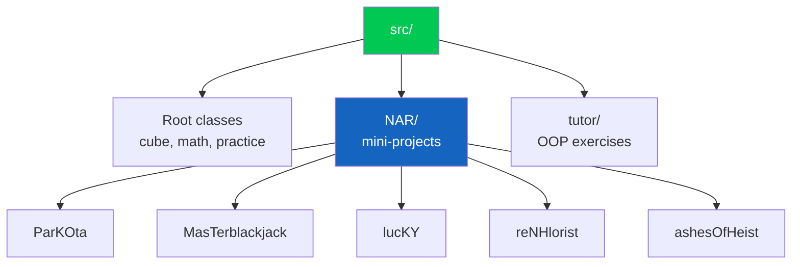

# ☕ UNI_JAWA

> A compilation of Java projects, exercises, and practice code from university and self-learning.

[](https://openjdk.org/)
[](https://www.jetbrains.com/idea/)
[](https://github.com/RCZ88/UNI_JAWA)

## 📖 About

This repository is a collection of small Java programs written while learning and practicing programming. It includes console applications, simple games, OOP exercises, and algorithm practice — all kept in one place for reference.

Most projects are run independently through their own `Main` class. Some are finished, some are experiments, and some are still a work in progress.

## 🗂️ What's Inside

| Project | Roughly |
|---------|---------|
| **ParKOta** | A console parking-lot management app |
| **MasTerblackjack** | A simple blackjack card game |
| **lucKY** | A minesweeper-style grid game |
| **reNHlorist** | A florist shop management system |
| **ashesOfHeist** | An RPG-style battle/dungeon model |
| **tutor** | Small OOP practice exercises |
| **Root classes** | Rubik's cube model, matrix math, and coding practice |

These are learning projects, so expect rough edges and unfinished parts.

## 🏗️ How It's Organized



## 🚀 Getting Started

### Requirements

- **JDK 21+**
- IntelliJ IDEA (recommended) or `javac` / `java`

### Clone

```bash
git clone https://github.com/RCZ88/UNI_JAWA.git
cd UNI_JAWA
```

### Run

The easiest way is to open the folder in IntelliJ IDEA and run any `Main.java`.

From the terminal:

```bash
# Compile
javac --release 21 --enable-preview -d out $(find src -name "*.java")

# Run an example project
java --enable-preview -cp out NAR.ParKOta.Main
```

Some files use Java 21 preview features, so preview mode must be enabled.

## 📁 Project Layout

```text
UNI_JAWA/
├── src/
│   ├── NAR/          # Mini-projects
│   ├── tutor/        # Practice exercises
│   └── *.java        # Standalone programs and experiments
├── .gitignore
└── README.md
```

## 🧠 Topics Practiced

- Object-oriented programming (classes, inheritance, enums)
- Basic data structures (arrays, lists, maps)
- Console I/O and simple game loops
- File handling
- Algorithm and problem-solving practice
- A bit of math (matrix determinants, cube modelling)

## 📄 License

No license declared. Please ask before reusing the code.

<div align="center">

**Made with ☕ and Java**

[Issues](https://github.com/RCZ88/UNI_JAWA/issues)

</div>
